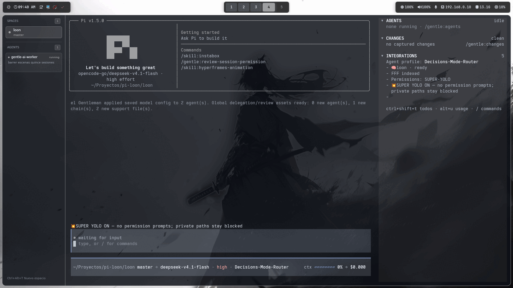

# LOON-Pi

Un paquete de pi que da a la TUI una **cabecera de arranque que respeta el tema**, y nada
más: la caja de pi-claude-code-tui, pintada por completo con el tema que ya usas.



*LOON Pi dentro de [PORT](https://github.com/loonbac/port) (Recomendado), mi propia terminal.*

## Hecho para Pi con gentle-pi

LOON **no es un tema que se pueda enchufar en cualquier terminal, ni un plugin suelto**. Es un
paquete de **Pi** pensado para correr sobre la configuración de **gentle-pi**: lee sus archivos
de configuración (`~/.pi/gentle-ai/`), se integra con su panel de Agents, con su menú
`/gentle:customize` y con sus fases ODD, y varias de sus piezas —el menú del banner, los glifos
de actividad— existen **solo** con el parche a gentle-pi aplicado.

Si no usas Pi, o lo usas sin gentle-pi, la mayor parte de este paquete no tiene dónde engancharse.

## Qué hace

- Dibuja una caja redondeada a lo ancho de la terminal: la etiqueta `Pi v<version>` en
  el borde superior, y después, a la izquierda, la marca de Pi en bloque, `Let's build
  something great` en negrita, la línea `provider/model · <effort> effort` y el cwd
  abreviado con `~`, con un divisor de acento y la barra lateral de sugerencias a la
  derecha.
- La sección izquierda se mantiene cuadrada: el divisor está al 42% del interior, pero
  la mitad izquierda nunca crece más de 40 columnas, porque diez filas de cuerpo se leen
  cuadradas con la marca y algo de aire. A 80 columnas son 32 + 44; a 120, 40 + 76, así
  que la marca nunca flota en una banda vacía y la barra lateral recibe ancho suficiente
  para nombres de comando reales.
- La regla corta bajo `Ask Pi to build it` llena la barra lateral y se detiene una
  columna antes del borde.
- Un identificador de modelo más largo que la mitad se ajusta en varias líneas en lugar
  de perder la cola: rompe por `/`, después por `-`, después por un espacio, y un tramo
  suelto sin separador se corta al ancho. Nada se sustituye por puntos suspensivos.
  `river/deepseek-ai/ DeepSeek-V4.1-Flash-1017 · high effort` pasa a tres filas
  centradas a 32 columnas, y la caja gana una fila por cada línea extra para que la
  barra lateral conserve su posición. Un ajuste cuya última línea quedaría con una sola
  palabra se reintenta una columna más estrecho hasta que caben dos palabras juntas,
  hasta la mitad del ancho, porque `openai-codex/gpt-5.5 · high` sobre un `effort`
  solitario se lee como un error.
- La marca es estática y de un solo color: una rejilla de 4 × 4 celdas de tres columnas,
  12 columnas de ancho y 4 filas de alto, dibujada con el acento del tema. Sin animación.
  Empieza dos filas por debajo del borde superior, a la altura de `Ask Pi to build it`,
  con una fila en blanco antes del eslogan, para que el ritmo coincida con la cabecera
  capturada.
- Resuelve todos los colores del tema activo mediante una única tabla
  (`extensions/lib/palette.ts`): caja, etiqueta, divisor, encabezados y marca usan
  `accent`; el eslogan usa `text` en negrita; las sugerencias y la línea del modelo usan
  `muted`; el cwd usa `dim`. La cabecera no emite ningún color SGR propio, así que se lee
  bien con los tres temas de gentle-pi, con system/dark/light y con cualquier tema del
  usuario.
- Cuando la terminal es demasiado estrecha para las dos columnas, la barra lateral se
  elimina y la mitad izquierda ocupa todo el ancho. Por debajo del ancho de la marca solo
  se imprime la etiqueta de versión.
- Se instala en la siguiente macrotarea después de `session_start` y luego vigila la
  cabecera en lugar de adivinar el momento del arranque. pi llama a `render` sobre el
  componente instalado, así que un hueco de render es prueba de que la cabecera en
  pantalla no es la nuestra: el vigilante vuelve a reclamarla (como máximo una vez por
  segundo) durante hasta 10 s y se detiene en cuanto un render sigue a una reclamación.
- Los retrasos fijos no funcionan y no se usan: medido en un arranque real, la TUI empieza
  a pintar hacia los ~1.9 s y gentle-pi registra su propio banner hacia los ~2.7 s
  (`setTimeout(..., 50)` abierto en `gentle-pi/extensions/startup-banner.ts:757`
  después de `await readBannerConfig()` en la línea 666: son los awaits, no los 50 ms,
  los que lo empujan tan tarde). Las reclamaciones a 0/120/400 ms se gastaron durante el
  arranque y gentle-pi se quedó con la cabecera; el vigilante la recupera hacia los
  ~1.6 s de su vigilancia.

## Comandos

Ninguno. LOON no registra comandos propios: encendido y apagado, origen del acento y
marca se cambian desde `/gentle:customize` de gentle-pi, con el parche de más abajo
aplicado. Sin ese parche no hay interfaz, y la configuración se edita en su archivo
(«Ajustes que añade LOON»).

## Instalación

**Gentle-pi es requisito, no opción.** LOON es una capa sobre gentle-pi: lee sus archivos
(`~/.pi/gentle-ai/`), se engancha a su menú `/gentle:customize` y a su panel de Agents, y
varias de sus piezas no tienen dónde existir sin él. Si no lo tienes instalado, instalar
LOON no tiene sentido.

```sh
pi install /home/loonbac/Proyectos/pi-loon/loon
```

O cárgalo desde un checkout, sin instalarlo:

```sh
pi -e /ruta/a/loon
```

Se instala **completo**. No hay variantes ni un perfil al que le falte algo: banner, color
automático, barras, tema derivado, las filas de LOON en `/gentle:customize` y el card style.

### El parche se aplica solo, y se repara solo

LOON edita archivos de gentle-pi, y **no hay un paso manual para eso**: instalar LOON es el
consentimiento. En cada arranque comprueba si sus marcadores siguen ahí y, si no están, los
vuelve a poner. Eso incluye el caso que antes rompía todo: un `npm update` de gentle-pi o de
pi reemplaza esos archivos por el build de stock, y el arranque siguiente los repara.

- Si los marcadores están, no cuesta nada: no se lanza ningún proceso.
- Si cambió gentle-pi de forma y las anclas ya no encajan, **no escribe nada**, conserva la
  copia de seguridad y te dice el archivo y el motivo. Eso es señal de que hace falta un
  LOON nuevo.
- Un fallo del parche nunca impide arrancar: el banner no depende de él.

```
$ node --experimental-strip-types scripts/gentle-pi-patch.ts check
extensions/gentle-shell.ts: patched
lib/shell-bar.ts: patched
...
```

### El color no depende de mi escritorio

El acento automático sale de un archivo con una línea `#RRGGBB`. Por defecto se lee el que
publica mi script de wallpaper, pero puedes apuntar a donde tú generes el color:

```json
{ "accent": "file", "accentFile": "/ruta/a/tu/color.txt" }
```

en `~/.pi/agent/loon-tui.json`. Sin configurar nada, la fuente `banner` manda y el acento es
el que ya elegiste en el menú de gentle-pi. No hay integraciones por herramienta (pywal,
matugen, wallust): una ruta, y el formato ya está resuelto.

El tema generado se deriva del **tema activo**, así que con `Gruvbox` activo se escribe
`Gruvbox (LOON)` y pi lo activa. Sin tema activo cae a `Wallpaper (LOON)`, que es lo que las
instalaciones existentes ya tienen.

`package.json` declara una extensión (`loon-startup.ts`) y ningún tema, imagen ni prompt.

## Pruebas

```sh
npm install   # dependencias de desarrollo para las pruebas y el comprobador de tipos
npm test      # node --experimental-strip-types --test
npm run typecheck
```

Las pruebas fijan la tabla de la paleta contra un tema de prueba que solo conoce los
roles que definen los tres temas de gentle-pi, la cabecera dorada a 80 y 120 columnas, la
posición del divisor, la rejilla de la marca, el orden literal de la barra lateral, el
ritmo vertical de la columna izquierda y la ausencia de secuencias de color crudas.

## Integración con gentle-pi

LOON lee los propios archivos de configuración de gentle-pi. No importa ningún módulo de
gentle-pi ni copia código suyo: analiza los dos archivos que esa extensión ya escribe, de
modo que lo que elijas en `/gentle:customization` llega a esta cabecera.

| Ajuste de gentle-pi | Archivo | Efecto aquí |
| --- | --- | --- |
| `density: comfortable` | `visual-customization.json` | La maquetación capturada: 12 filas de cuerpo con la marca, el eslogan, el modelo y el cwd. |
| `density: compact` | `visual-customization.json` | Sin fila en blanco sobre la marca y sin eslogan: marca, modelo, cwd; la barra lateral pierde la regla corta. |
| `density: minimal` | `visual-customization.json` | Una caja de tres filas con una: `provider/model · effort effort`, cortada con `…` cuando no cabe. Sin marca, sin eslogan, sin cwd, sin barra lateral. |
| `headerPlacement: top` | `visual-customization.json` | LOON conserva el hueco superior, como siempre hizo. |
| `headerPlacement: below-input` | `visual-customization.json` | Mueve la **barra propia** de gentle-pi bajo el editor. El banner no se ve afectado: vive en el hueco de cabecera de pi y se queda arriba. |
| `color: pink\|cyan\|yellow\|green` | `banner.json` | Sustituye el acento: caja, divisor, encabezados y marca. `text`, `muted` y `dim` siguen viniendo del tema. |
| `showTextLogo` | `banner.json` | **No aplica.** Oculta el logotipo ASCII de gentle-pi, que este paquete no dibuja; la marca de Pi tiene su propio interruptor más abajo. Se lee, se valida y se ignora. |
| `showRose` | `banner.json` | **No aplica.** LOON no tiene rosa. Se lee, se valida y se ignora. |

Las dos filas de `No aplica` son deliberadas. Esos flags los escribió un menú que gobierna
el banner propio de gentle-pi, no la marca de Pi, así que respetarlos aquí borraría un
glifo que este paquete dibuja y que alguien dimensionó a propósito.

Las lecturas son tolerantes a propósito. Un archivo ausente, un JSON malformado, un
esquema de otra versión, una clave desconocida o un valor que no valida caen todos a la
maquetación de arriba (comfortable, top, marca activada, acento del tema): nunca un error,
nunca un banner distinto. Cada cambio se recoge en vivo: se vigilan los dos directorios de
configuración, así que editar los ajustes de gentle-pi repinta sin reiniciar pi.


### Acento del fondo de pantalla

Con el escritorio ya recoloreándose a partir del fondo de pantalla, el banner puede seguir
el mismo color. `accent: "wallpaper"` hace que los roles de acento —caja, divisor,
encabezados y marca— usen el `#RRGGBB` de `~/.config/mpvpaper/accent.txt`; `text`,
`muted` y `dim` siguen viniendo del tema.

- El archivo se escribe de forma atómica (`write · fsync · os.replace`), así que su inodo
  cambia con cada fondo de pantalla. Por eso LOON vigila el **directorio**
  `~/.config/mpvpaper`, nunca el archivo, y un cambio de fondo recolorea una sesión en
  marcha sin reiniciar pi.
- Un archivo ausente, ilegible o malformado cae al acento del tema —nunca negro, nunca
  una caída— y la vista previa de su fila lo dice:
  `Wallpaper accent · unavailable (static)`.
- Con el menú de gentle-pi parcheado, la elección es una quinta fila,
  `Banner color: wallpaper`, cuya vista previa dice
  `Wallpaper accent · #9B484A (static)`. Elegir cualquiera de los cuatro colores
  con nombre escribe `accent: "banner"` en la misma escritura, así que volver del color
  del fondo nunca es una operación silenciosa sin efecto.
- No se escribe nada en `banner.json`: su propia clave `color` conserva su formato de
  cuatro valores. En modo `source: "rose"` el banner de gentle-pi lee `banner.json`, así
  que este acento no le afecta, por diseño.

La elección es una fila del menú, no un comando:

```sh
/gentle:customize   # Banner color: theme | <color> | wallpaper (LOON)
```


### El tema del fondo de pantalla

LOON puede instalar un tema real de pi, de modo que elegirlo en la lista Themes de
gentle-pi recolorea toda la interfaz, no solo el banner. Se llama `Wallpaper (LOON)`:
cada tema que este paquete incluye o genera termina en ` (LOON)`, y el nombre del archivo
deriva del nombre (`Wallpaper (LOON).json` en el directorio `themes/` del agente de pi),
así que los dos no pueden separarse.

- La paleta se deriva del acento del fondo de pantalla en OKLCH: los roles de interfaz se
  quedan en croma muy bajo alrededor de ese matiz, los roles de sintaxis son rotaciones de
  matiz con croma limitada, y el color del fondo de pantalla es el acento.
- Los pisos son duros y las pruebas los hacen cumplir: texto sobre fondo >= 7:1, muted
  >= 4.5:1, acento >= 3:1. Un fondo de pantalla que no los alcanza conserva su matiz y se
  le empuja la luminosidad hasta que los alcanza, así que incluso negro o blanco producen
  un tema válido.
### Contraste, medido
La paleta se deriva, así que estos números salen de la propia derivación y las pruebas
afirman los pisos. Dos ejemplos, el acento del fondo de pantalla y uno violeta:

| pareja | `#AB9A5E` | `#D5A9F0` | piso |
| --- | --- | --- | --- |
| texto / fondo (`#100D04` / `#100B13`) | 17.32:1 | 17.29:1 | >= 7:1 |
| muted / fondo | 8.16:1 | 8.06:1 | >= 4.5:1 |
| acento / fondo | 6.95:1 | 9.97:1 | >= 3:1 |
| texto / superficie de tarjeta (`#3D3823` / `#3F3446`) | 10.5:1 | 10.4:1 | >= 7:1 |
| superficie de tarjeta / fondo | 1.65:1 | 1.65:1 | 1.65..1.69 |
| croma de la superficie de tarjeta | 0.035 | 0.034 | 0.010..0.035 |

Las superficies de tarjeta (`toolSuccessBg`, `toolPendingBg`, `toolErrorBg`) no son
colores de estado: gentle-pi pinta con ellas el fondo de sus tarjetas INFO, SUCCESS,
PENDING y ERROR y lleva el tono en el borde y el título.

Se colocan por **contraste contra el fondo**, no por una luminosidad:
`CARD_SURFACE_CONTRAST` vale 1.65 y la derivación resuelve la luminosidad que lo alcanza,
así que la banda se lee igual sobre un fondo dorado y sobre uno azul. Una luminosidad fija
no puede prometer eso: un valor midió 1.16 contra un acento y otra cosa contra otro, y así
fue como la banda salió una vez con un tinte y después desapareció.

Las tres superficies son una sola superficie de acento en tres peldaños de esa escalera:
1.65, 1.69 y 1.73 (`CARD_SURFACE_STEP` vale 0.02 de contraste). El hueco es pequeño a
propósito, y un peldaño que redondea sobre el de abajo sube más alta en su lugar, porque
dos de ellas colapsaron una vez en un solo hex y gentle-pi pintó las tarjetas INFO,
PENDING y ERROR de un único color plano.
- El archivo se escribe de forma atómica y solo cuando falta, es ilegible o es más viejo
  que `accent.txt`; un archivo con ese nombre cuyo `name` propio no es el nuestro se deja
  intacto y LOON trabaja con el tema que haya, sin tocarlo.
- Con `Wallpaper (LOON)` activo, el acento del tema ya no coincide con el crudo del
  fondo de pantalla: el tema eleva su rol `accent` para que las tarjetas INFO lean su
  título. Qué pinta el banner lo decide el ajuste `accent` y nada más; un atajo anterior
  que lo ignoraba mientras el tema generado estaba activo se eliminó por eso.

En gentle-pi no se parchea nada para esto: su categoría Themes se construye en tiempo de
ejecución a partir de los temas instalados, así que un archivo de tema real produce la
fila `Theme: Wallpaper (LOON)` por sí solo. Regenerar el archivo con una sesión en marcha
la recolorea, porque pi recarga en caliente el tema activo.

```sh
/gentle:customize   # Themes -> Theme: Wallpaper (LOON)
```
### Quién pinta el banner: el parche opcional de gentle-pi

El menú de gentle-pi es el único lugar donde una persona configura su banner, así que LOON
también puede aparecer *ahí*: como un tercer estado de una sola fila, junto al banner
propio de gentle-pi y a la cabecera nativa de pi. Eso necesita un parche pequeño y
reversible del paquete instalado, aplicado con la herramienta de este repositorio:

```sh
node --experimental-strip-types scripts/gentle-pi-patch.ts check
node --experimental-strip-types scripts/gentle-pi-patch.ts apply
node --experimental-strip-types scripts/gentle-pi-patch.ts revert
```

Qué cambia, siete archivos, cada una por una razón, contra **gentle-pi 4.6.0**. De las 32
anclas, 26 son idénticas a 4.5.1 y 6 se movieron; cada una está justificada en
`odd/tasks/gentle-pi-menu-map.md` (qué cambió en 4.6.0 en ese punto y por qué la nueva es el
mismo sitio lógico). `check` nombra cualquier ancla que falte y el parche **se niega antes de
escribir nada**: no hay aplicación parcial.

**Un `pi update` borra este parche, siempre.** No hay re-aplicación automática al arrancar
sesión, y eso es un problema abierto, no una nota al pie: tras cada actualización de gentle-pi, la
geometría LOON, la barra sin marca y las filas de banner desaparecen hasta que alguien corra
`apply`. Detectar el borrado desde el arranque es fácil y barato; **escribir** `node_modules` al
iniciar sesión no lo es —una actualización a medias o un `npm ci` en paralelo convertirían el
arranque en una escritura silenciosa sobre el paquete—, así que `apply` sigue siendo un acto
explícito del dueño.

- `extensions/gentle-shell.ts`: `/gentle:customize` recibe una fila,
  `Banner: loon` / `Banner: rose` / `Banner: off`, que cicla al seleccionar.
  `Banner rose:` y `Banner text logo:` desaparecen; la fila del logotipo de texto sigue
  alcanzable dentro de `rose`, donde todavía significa algo, y `Banner color:` sigue
  funcionando en todos los estados (colorea su ilustración en `rose` y el acento de esta
  cabecera en `loon`). Las filas del acento son `Banner color: theme (LOON)`, los cuatro
  colores con nombre y `Banner color: wallpaper (LOON)`, y `Mark: on|off` es el
  interruptor de la marca de Pi.
- `extensions/startup-banner.ts`: el banner de gentle-pi no instala su cabecera en `loon`
  ni en `off`, así que nada se pelea por el hueco.
- `lib/visual-customize-view.ts`: la etiqueta de una fila se llama con el ancho que la
  fila realmente tiene, de modo que una etiqueta larga puede elegir una formulación más
  corta en lugar de quedar cortada a mitad de palabra. Sin esto, la vista no ofrece ningún
  ancho.
- `lib/shell-bar.ts`: con un tema generado por LOON, la barra del shell suelta su marca y
  deja de anunciar el atajo de usage. Esos temas llevan `" (LOON)"` al final del nombre;
  la cabecera ya dice qué herramienta es esto, y `alt+u` es un atajo que se aprende una
  vez. Cualquier otro tema conserva `✿ Gentle Shell` y `usage · alt+u` exactamente donde
  estaban, y un tema cuyo nombre no se puede leer falla abierto: marca visible, pista
  visible.

  Un único helper decide «¿es este un tema LOON?», y las dos decisiones lo leen. Sin él,
  la barra, las etapas izquierdas de la cabecera y sus anchos de último recurso probarían
  el nombre cada una por su cuenta. Una marca oculta no deja separadores sueltos ni filas
  vacías —la etapa más estrecha pasa a ser el identificador de modelo desnudo— y una pista
  de usage oculta se lleva el segmento entero cuando no hay nada que informar: ningún
  `usage` huérfano sin medidores. Ocultar la pista no desregistra el atajo; `alt+u` sigue
  abriendo el panel de usage, solo deja de anunciarse.

La banda de la tarjeta del prompt no necesitó parche al final: un tema tiñe sus
superficies con su acento, así que en cuanto nuestra paleta dejó de pintar las tarjetas
de verde, la banda la siguió.

La elección se guarda como `source` en el `loon-tui.json` propio de LOON, nunca en
`banner.json`: gentle-pi reescribe ese archivo con sus tres claves y la perdería.
Semántica:

| `source` | quién pinta |
| --- | --- |
| `loon` (por defecto) | esta cabecera; gentle-pi se queda fuera cuando está parcheado y pierde la carrera cuando no lo está |
| `rose` | el banner de gentle-pi; LOON libera el hueco y nunca lo reclama |
| `off` | nadie: la cabecera propia de pi |

La herramienta no exige que el archivo sea exactamente la compilación 4.5.1 contra la que
fue escrita: exige que cada ancla aparezca exactamente una vez. Un cambio de gentle-pi que
no toque ningún ancla no la detiene; uno que mueva un ancla sí, y entonces lo dice con el
detalle de abajo. Además,
importa la copia parcheada en un proceso hijo con el mismo cargador que usa pi *antes* de
reemplazar nada, y guarda una copia de seguridad con marca de tiempo en
`~/.pi/agent/backups/gentle-pi-banner-patch-*` que `revert` restaura y verifica. Aquí nada
es obligatorio: sin parche, LOON funciona exactamente como antes.

### El menú nuevo: qué ajuste vive en qué categoría

gentle-pi 4.6.0 reorganizó `/gentle:customize` en doce categorías (`Animations, Banner,
Themes, Editor, History, Notifications, Layout, Cards, Sections, Keymaps, Profiles, Reset`).
Ningún ajuste cambió de archivo; sí de sitio en el menú, y apareció uno nuevo:

| Ajuste | Archivo | Categoría |
| --- | --- | --- |
| tema `Wallpaper (LOON)` | `settings.theme` + `~/.pi/agent/themes/` | **Themes** |
| banner rosa, sin rosa, sin logotipo | `banner.json` | **Banner** |
| política de animación | `animations.json` | **Animations** |
| colocación de estado, cabecera, densidad | `visual-customization.json` | **Layout** |
| secciones visibles | `visual-customization.json`, `visibility` | **Sections** |
| estilo y contenido de tarjeta | `card-style.json`, `card-content.json` | **Cards** |
| perfil completo (nuevo en 4.6.0) | `visual-profiles.json` | **Profiles** |

Ese directorio (`~/.pi/gentle-ai/`) es del dueño: lo controla una guarda que ninguna
herramienta del modelo puede cruzar, así que el repositorio **publica** el payload y el
dueño lo instala con una orden. Los dos archivos del payload validan con los parsers de
gentle-pi, no con una copia de sus reglas:

```sh
node scripts/gentle-ai-payload.mjs show     # el payload y la orden
node scripts/gentle-ai-payload.mjs verify   # lee el directorio vivo y enumera problemas
node scripts/gentle-ai-payload.mjs apply    # copia (con backup) y verifica: lo corre el dueño
```

Por qué hacía falta: `card-style.json` guardaba `"loon"`, el estilo que añade el parche de
más arriba, y cuando una actualización borró el parche el lector lo marcó `malformed`,
resolvió `float` y la categoría **Cards** se negó a guardar nada. Con el parche puesto,
`loon` vuelve a ser válido y el archivo del dueño **no se toca**: el payload publica `loon`
y `apply` se niega a escribir un estilo que la instalación no sepa leer, diciendo el comando
que falta.

Y `visual-profiles.json` define el perfil `loon` con el tema, el banner, la animación y las
ocho claves de `visibility` que el validador estricto exige, para que el perfil sobreviva a
un guardado desde el menú. Su `banner` (**`showRose`: false, `showTextLogo`: false, `pink`)
son valores **inertes**, no los valores por defecto de nada: un perfil no puede omitir esa
clave —el esquema exige las cinco exactas—, y mientras `loon-tui.json` diga
`source: loon` u `off`, el banner parcheado de gentle-pi ni siquiera se instala, así que el
perfil no manda ahí. La autoridad es `loon-tui.json`; los valores están puestos para que, si
algún día cambia la fuente a `rose`, se vea lo que el perfil dice y no una sorpresa.

### Cuando una actualización borra el parche, se avisa

`pi update` reemplaza los archivos parcheados, **siempre**. Eso deja al dueño sin geometría
de tarjetas, sin barra sin marca y sin filas de banner, y la vez que pasó se enteró horas
después. Así que al arrancar sesión LOON lo dice, en una **clave de estado** (`loon:patch`,
`ctx.ui.setStatus`) que sobrevive al scrollback en vez de ser una línea que se va:

- lee los siete archivos del paquete y busca la marca que solo escribe el parche
  (`extensions/lib/patch-notice.ts`); si falta alguna, nombra **qué** se perdió, cuántos
  archivos son y el **comando exacto con la ruta absoluta** del repositorio;
- se limpia solo: en el primer arranque en que las marcas están de vuelta —esto es, después
  de que `apply` haya corrido— la clave se borra, así que un aviso viejo no se queda
  mintiendo;
- **no escribe nada**: es lectura pura. Escribir `node_modules` al arrancar sesión
  convertiría una actualización a medias o un `npm ci` en paralelo en una escritura
  silenciosa sobre el paquete, que es el mismo fallo con otra cara. `apply` sigue siendo un
  acto explícito del dueño.

La tabla de marcas se compara en un test con los destinos del parche: añadir un archivo al
parche sin añadirlo al aviso rompe la suite, en vez de dejar un archivo cuya pérdida nadie
cuenta.

**Y una regla que salió de un error propio: nunca se vendoriza un paquete ajeno dentro de un
commit de trabajo.** Los bytes prístinos contra los que se miden los digests del parche no están
en el repositorio —llegaron a ser 6.900 de 7.779 líneas de un candidato y lo sacaron del
presupuesto del revisor—, sino que se resuelven en tiempo de ejecución
(`tests/support/pristine.ts`), en este orden: `GENTLE_PI_ROOT`, el backup más nuevo del parche, y
el paquete instalado **solo mientras esté sin parchear**. Lo que se commitea es
`tests/fixtures/pristine-digests.json`: un SHA-256 por archivo. Cada archivo se hashea antes de
usarse; si falta, el test se **salta con su motivo**; si un byte no coincide, el test **falla**,
porque no son los bytes que se midieron. En la caja, sin paquete, `GENTLE_PI_ROOT` apunta a una
copia prístina; sin eso esos tests se saltan, nunca pasan por no haber podido comprobar.

El repo no declara CI: "verde en la caja" es `npm test` dentro de una instabox, y la
transferencia de prístinos la hace **el script**, no la memoria de quien lo corre:

```sh
scripts/box-verify.sh <caja>
```

Resuelve la copia prístina, la transfiere, **la hashea contra el registro antes de correr nada** y
solo entonces ejecuta `typecheck` y la suite con `GENTLE_PI_ROOT` puesto. Una copia incompleta o
con un byte distinto detiene el run con el motivo, en vez de convertir los digests en saltos que
una línea de resumen lee como verde. Con la copia verificada, los tres tests de digests **pasan**;
los demás saltos de una caja son `gentle-pi is not installed here`, es decir los que cargan el
paquete instalado — y esos no se arreglan transfiriendo prístinos.

### Medir un frame

Cada frame de este repositorio sale de un único script, porque la alternativa es medir
encima de la configuración real de la persona:

```sh
scripts/probe-frame.sh capture --label brand-stock-120 --width 120 --height 32 --theme Gentle
```

Toma una instantánea de `settings.json`, `loon-tui.json`, el
`visual-customization.json` y el `banner.json` de gentle-pi, más el directorio de temas, a
un directorio de estado bajo `~/.local/state/loon-probe`; ejecuta pi en tmux contra **su
propia** configuración de gentle-pi, nunca la real; captura el frame; restaura la
instantánea; y verifica cada sha256 contra lo que registró. Una diferencia es la salida 3,
y la restauración también se ejecuta cuando la captura falla o se interrumpe.

Dos detalles importan. Un archivo ausente se restaura como ausente, y un archivo que ya
estaba parcial se restaura con sus bytes exactos: nunca se reconstruye desde los valores por
defecto. Y la instantánea se escribe antes de que pi arranque: si no se puede escribir, pi
no arranca en absoluto.

Esto existe porque scripts anteriores hechos a mano escribían y borraban
`~/.pi/agent/loon-tui.json` sin restaurarlo, lo que dejaba atrás un archivo de una sola
clave y hacía parecer que las elecciones de la persona se reiniciaban solas.

### Ajustes que añade LOON

El menú propio de gentle-pi escribe `banner.json` y `visual-customization.json`, y ese
archivo tiene tres claves fijas, así que LOON mantiene las suyas aparte, en
`loon-tui.json`, dentro del directorio de configuración de pi
(`$PI_CODING_AGENT_DIR`, o `~/.pi/agent`):

```json
{ "enabled": true, "accent": "banner", "mark": true, "source": "loon" }
```

- `enabled`: false significa que LOON no pinta nada y nunca reclama la cabecera, así que
  el banner propio de gentle-pi queda libre para tomar el hueco.
- `accent`: `banner` sigue el `color` de gentle-pi, `theme` conserva el rol `accent` del
  tema, y `wallpaper` sigue el archivo del fondo de pantalla (ver más abajo). Por defecto
  es `banner`, así que un color ya elegido en el menú de gentle-pi se respeta desde el
  primer momento.
- `mark`: la marca de Pi, activada por defecto. Este es el interruptor de LOON, no el
  `showTextLogo` de gentle-pi: ese flag pertenece a otro banner y nunca llega a este
  glifo.
- `source`: quién pinta el banner: `loon` (por defecto), `rose` u `off`. Lo escribe la
  fila parcheada del menú de gentle-pi; sin el parche simplemente se queda en `loon`.

Con el parche aplicado, cada clave tiene su fila en `/gentle:customize`:

| Fila | Qué escribe |
| --- | --- |
| `Banner: loon` / `rose` / `off` | `source` |
| `Banner color: theme (LOON)` | `accent: "theme"` |
| `Banner color: <color>` | `color` en `banner.json` y `accent: "banner"` |
| `Banner color: wallpaper (LOON)` | `accent: "wallpaper"` |
| `Mark: on` / `off` | `mark` |

Sin el parche no hay interfaz, y el archivo es el mando: LOON lo vigila, así que editarlo
a mano tiene el mismo efecto y repinta sin reiniciar pi. Para apagar el banner del todo,
sin depender de nada más:

```json
{ "enabled": false, "source": "off" }
```

Las escrituras son atómicas (un archivo temporal en el mismo directorio y después un
renombrado), y un archivo ilegible significa los valores por defecto, nunca una caída.

Dos límites que conviene conocer. Cambiar `headerPlacement` con pi en marcha deja la
cabecera incorporada de pi arriba hasta el siguiente arranque, porque gentle-pi solo
instala su banner al iniciar la sesión; el banner propio de LOON se mueve de inmediato.
Y cuando gentle-pi no está instalado en absoluto, nada cambia: ni archivos, ni
sobrescrituras, ni la cabecera de hoy.

## Lo que NO hace

- **No tiene tema propio.** No hay entrada en `pi.themes` ni tema JSON aquí: los colores
  vienen del tema que esté activo.
- Sin animación, sin verbos de mensaje de trabajo (nunca se llama a
  `ctx.ui.setWorkingMessage`), sin pie ni spinner propios.
- Sin cambios en el editor, la caja de entrada ni el título de la ventana.
- Aplicar la cabecera toca solo `ctx.ui.setHeader` y nunca sigue el `headerPlacement` de
  gentle-pi: ese ajuste mueve la barra propia de gentle-pi, y el banner se queda en el
  hueco de cabecera de pi tanto si la barra va arriba como si va bajo el editor. Nada más
  de la interfaz de pi se reemplaza: el pie y el spinner no se tocan nunca.

## Cuando gentle-pi cambia

Después de actualizar `pi` o gentle-pi, correr `check` antes que `apply`: si el resultado es
`different-version`, el problema se arregla ahí, no abriendo `pi` y descubriendo que el banner
no está.

El menú es texto insertado en un paquete ajeno, así que la pregunta es qué pasa cuando
gentle-pi se actualiza. La respuesta son dos reglas, y la primera es la que importa:

- **Si el cambio no toca ningún ancla, el parche sigue funcionando.** No hay que
  intervenir. Un comentario nuevo, una función que se movió de sitio, un archivo que
  creció: nada de eso es un problema, aunque el md5 del archivo sea otro. Aplicar sobre
  una compilación distinta de la probada se permite y se avisa:

  ```
  gentle-pi 4.6.0: 30 anchors intact, version not tested (this patch was written against 4.5.1)
  ```

- **Si el cambio toca un ancla, el parche se rompe a propósito.** No aplica nada (salida
  2, cero bytes escritos) y dice qué arreglar:

  ```
  lib/shell-bar.ts: not the build this patch was written against
    md5:      expected c5b38192…, found e119c8be…
    version:  installed 4.6.0 · patch pinned to 4.5.1
    anchor:   scripts/gentle-pi-patch.ts:232 (shellBarStagesTail) occurs 0 time(s), expected 1
      expected: [brand, location, withProfile],
      found:    line 282: const withProfile = model.profile ? `${withEffort} …
    nothing was written: no file changed and no backup was created
  ```

Un ancla que aparece dos veces también rompe el parche, por ambigüedad: sustituir la
primera cuando hay dos sería adivinar. Y el resultado se verifica antes de escribirlo: cada
reemplazo tiene que haber caído exactamente una vez.

`check` dice lo mismo antes de intentar nada:

```sh
node --experimental-strip-types scripts/gentle-pi-patch.ts check
```

Deshacer no depende del md5 de gentle-pi 4.5.1: cada respaldo guarda el archivo que había
antes y el md5 de lo que el parche escribió, así que `revert` devuelve exactamente el
archivo que estaba ahí—aunque no fuera la versión probada—y se niega si lo instalado ya no
es lo que este parche escribió, porque entonces lo que hay es de otra persona.

Sin el parche aplicado LOON funciona igual: lee su archivo, pinta su cabecera y no
depende de que ese texto esté en el paquete. Lo único que falta entonces es el menú.

## La familia LOON

LOON es un conjunto de paquetes de Pi independientes que comparten nombre y estilo.
Instalar uno nunca exige otro: la familia es una referencia cruzada, no una dependencia.

| Paquete | Qué hace |
| --- | --- |
| `loon` | Esta cabecera de arranque, pintada con el tema activo. |
| `loon-routing` | Elige proveedor, modelo y esfuerzo con evidencia suficiente para la tarea. |
| `loon-ghost-tools` | Convierte el nombre de una herramienta inventada en un mensaje accionable. |
| `loon-jev-context-guard` | Le pregunta a Jev cuándo compactar, abrir sesión nueva o guardar memoria. |

Los addons viven en repositorios privados mientras maduran; sus nombres son los de la
tabla y cada uno se instala por separado.

## Descubrimiento en Gentle Shell

LOON se puede listar en el catálogo de Gentle Shell, que agrupa los recursos por *topic*
del repositorio. Los topics son la única declaración: sin ellos no apareces en el
catálogo, y con ellos la aparición es **eventual**, sin calendario prometido.

| Topic | Para qué |
| --- | --- |
| `gentle-shell-package` | Repositorio público de un recurso de shell. Es el que corresponde a LOON: un paquete de Pi con extensiones y temas. |
| `gentle-hub-project` | Cualquier proyecto público de la comunidad. Alternativa cuando el repositorio no es, en sí, un recurso de shell. |

Los subtopics de recurso son **opcionales**. Sin ninguno, la entrada se lista como
`Resource` y nadie adivina el subtipo por ti. LOON declara dos, porque hace las dos cosas:

| Subtopic | Qué declara en LOON |
| --- | --- |
| `gentle-shell-extension` | `extensions/loon-startup.ts`, la extensión única del paquete. |
| `gentle-shell-theme` | El tema `Wallpaper (LOON)` y sus derivados OKLCH. |

Los otros dos existen para otros recursos: `gentle-shell-skill` para un paquete de skills y
`gentle-shell-prompt` para uno de plantillas de prompt. LOON no los usa.

## Convenciones de idioma

- Documentación de usuario (`README.md` y la documentación del proyecto): **español**.
- Artefactos de trabajo del agente (`odd/tasks/*.md`): **inglés**.
- `AGENTS.md` y `NOTICE`: **inglés** (manifiesto del usuario y atribución legal).
- Comentarios de código, identificadores y mensajes de commit: **inglés**.

## Licencia

MIT. La maquetación de la caja, la barra lateral de sugerencias y los ayudantes de ancho
derivan de [pi-claude-code-tui](https://github.com/Phoobobo/pi-claude-code-tui) (MIT); la
marca estática de Pi es propia de LOON. Ver `NOTICE` para la atribución y el texto de la
licencia original.